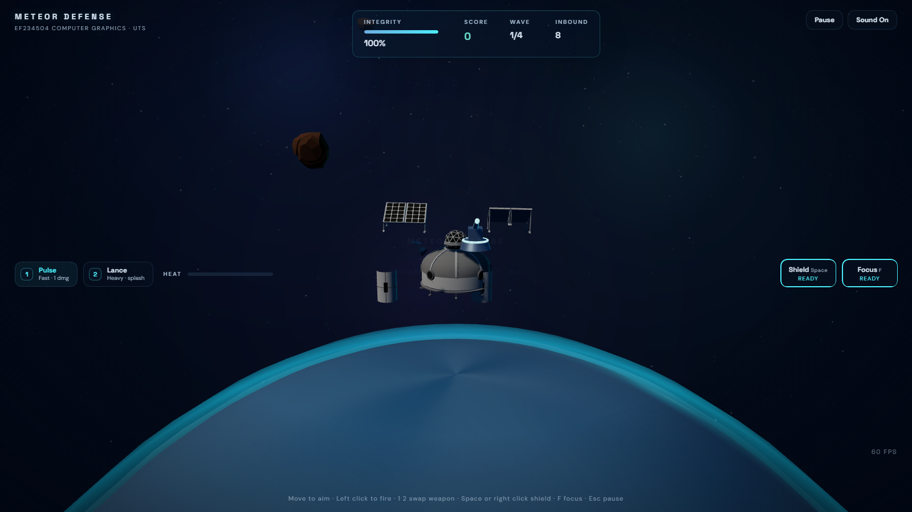
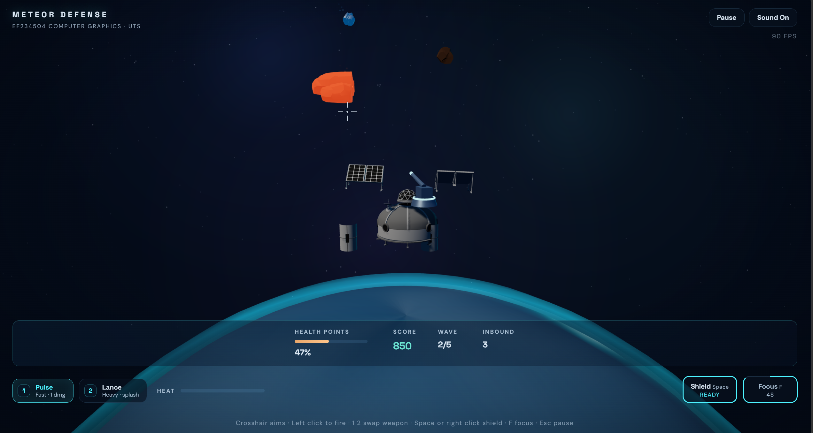
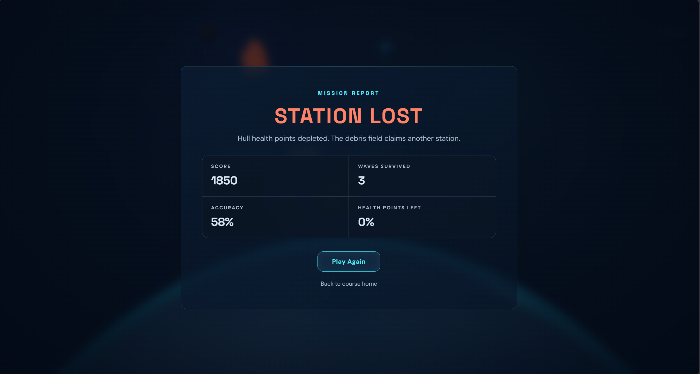

# UTS - Meteor Defense - Interactive 3D Mini Game

**Author** Anak Agung Putu Arda Nareswara
**NRP** 5025241074
**Class** B

Web https://ardanareswara-computer-graphics.vercel.app

This is my midterm exam project for Computer Graphics, the interactive web 3D
project for Topik 10 Meteor Defense. An orbital station hovers above a
planet while four waves of meteors dive at it. The player aims a turret with
the pointer, fires one of two hitscan weapons, watches the heat gauge, raises
a recharging shield, and bends time with a focus field until the boss
asteroid breaks apart or the hull gives way. The whole game runs in one
Three.js scene with imported GLB assets, particle effects, procedural audio,
and a health plus score HUD, so every building block from the module stands
in one working piece.







## Running the project

Install the dependencies from the repository root and start Vite.

```sh
npm install
npm run dev
```

Open the URL printed by Vite and pick "UTS Meteor Defense" from the home
page, or go straight to the midterm path. The build and preview commands
below produce and serve the production files from the deploy folder.

```sh
npm run build
npm run preview
```

## Controls

- Move the crosshair to aim the turret, left click to fire at it
- Keys 1 and 2 swap between the Pulse and the Lance, the chips in the
  bottom bar do the same
- Space or right click raises the shield, key F activates the focus field
- Escape pauses, M mutes the sound, the top right buttons mirror both

## Gameplay

The station holds 100 integrity points. Every meteor that reaches it takes
its damage out of the hull, and the run ends when the hull hits zero. Four
waves arrive in sequence and the last one brings a boss asteroid with six
escorts. Clearing a wave restores the hull, a flawless wave pays a bonus,
and every destroyed meteor scores points by type. The turret overheats if
the trigger is held too long, so the two weapons trade fire rate against
heat and damage. The shield absorbs ordinary meteors on contact while the
boss punches through it, and the focus field slows the whole simulation
to a third for four seconds which makes the boss split dodgeable.

| Wave | Content | Meteor types |
|---|---|---|
| 1 | 8 meteors on a loose interval | rock plus ice |
| 2 | 12 meteors, faster | rock plus ice plus hulk |
| 3 | 14 meteors, quick interval | rock plus ice plus hulk |
| 4 | boss asteroid plus 6 escorts | everything plus the boss |

## Meteor types

- Rock, the standard, 2 hit points at pulse damage 1
- Ice, fast and fragile at 1 hit point with a cold glowing trail
- Hulk, slow and heavy at 5 hit points, hits the hull for 16
- Boss, 60 hit points, splits into three rocks at forty percent health,
  hits the hull for 40

Each type reuses one of three downloaded GLB rocks through cloning, and
each instance owns cloned materials so hit flashes stay local to the rock
that was struck.

## Weapons and abilities

- Pulse, 1 damage per shot, fast, low heat, the default
- Lance, 9 damage on a direct hit plus splash within 2.2 units, slower,
  three times the heat of a pulse shot
- Heat rises per shot and overheat locks the cannon until it cools below
  the release threshold
- Shield, 4.5 seconds of cover on a 16 second recharge
- Focus, 0.35 time scale for 4 seconds on a 20 second recharge

## Scene graph

```text
Scene
├── HemisphereLight plus shadowed DirectionalLight plus rim light
├── Starfield layers plus nebula sprites
├── Planet sphere plus cloud shell plus atmosphere rim
├── Station group
│   ├── Core, the habitat dome from station-base.glb
│   ├── Dome, the geodesic greenhouse from station-dome.glb
│   ├── SolarWings group
│   │   ├── Solar panel left from station-panel.glb
│   │   └── Solar panel right, a clone turned around
│   ├── Arm pod left and right from station-arm.glb
│   ├── RadarPivot group
│   │   └── Dish from station-radar.glb
│   ├── DefenseSystem turret
│   │   ├── Base ring
│   │   └── Yaw group plus pitch group plus barrel plus glowing muzzle
│   └── Shield bubble, a fresnel shader sphere
├── Meteor instances, each a cloned GLB rock under its own group
└── Effect pools, particles plus sprites plus beams
```

The turret is the clearest parent child chain in the game. The yaw group
refuses to inherit pitch, the pitch group refuses to inherit yaw, and the
muzzle is an empty that rides both, so the barrel sweeps a hemisphere
without ever gimbal locking and the muzzle world position feeds every beam
and muzzle flash.

## GLB models

Eight CC0 models from the Quaternius Ultimate Space Kit load through
GLTFLoader from the public models folder. Three rocks become the meteor
types and five station modules assemble the base. Every model is
measured with a Box3 after load and rescaled, so raw units do not matter,
and clones are taken before fitting so no shared template is ever mutated.
All meshes cast and receive shadow.

## Environment and lighting

Lighting is one shadow casting directional sun, a hemisphere ambient and a
cyan rim light. The environment map is procedural, a small PMREM rendered
scene with a gradient shell, a glowing planet and star points, so PBR
metal on the station reads without any HDR file. The real planet below
carries procedural fbm noise textures for roughness and clouds, and its
atmosphere is a fresnel backside shader.

## Effects and audio

- A single additive particle pool covers sparks, debris and trails for
  every impact, and its colors fade through a base color array
- Sprite flashes and expanding rings mark muzzle fires, hits, shield
  contacts and explosions
- Beam shots animate as stretched additive cylinders from the muzzle
- Camera shake is amount based and decays exponentially, with random roll
- Damage flashes a vignette, low integrity pulses it red
- All audio is synthesized with WebAudio oscillators and filtered noise,
  so there is not a single sound file in the project. The context unlocks
  on the first click and the mute button persists per session

## Interaction list

1. Pointer aiming with a hover highlight on the meteor under the cursor
2. Left click hitscan firing with heat management and overheat lockout
3. Weapon switching through the 1 and 2 keys or the HUD chips
4. Shield activation on Space or right click, plus the HUD button
5. Focus time dilation on F, plus the HUD button
6. Pause on Escape or the button, with auto pause when the tab hides
7. Restart from the end screen, the pause screen or the menu

## Requirement checklist

- Three.js scene with a scene graph and a visible parent child chain, met
- PBR materials with roughness and metalness on every imported module, met
- Lighting with a shadowed light and a documented shadow chain, met
- Environment lighting through a procedural PMREM scene, met
- Imported GLB assets, eight of them, loaded with GLTFLoader, met
- Object movement animation through delta time plus VFX animations, two
  kinds, met
- Raycasting from the pointer through the camera to meteors, met
- At least three interactions, seven are listed above, met
- At least two visual effects, particles plus sprites plus beams are
  three, met
- Health and score HUD with wave and inbound counters, met
- At least three waves, four are present, met
- At least two meteor types, four are present, met
- Win and lose states with restart, met
- Optional challenges, multiple weapons, slow motion focus, camera
  shake, procedural sound with mute, shield recharge, and a boss final
  wave, all present

## Assets and credits

Meteor rocks, habitat dome, geodesic dome, solar panel, comm dish and pod
modules are from the Ultimate Space Kit by Quaternius, CC0, downloaded
through Poly Pizza as GLB files. The planet, clouds, atmosphere, starfield,
nebula, turret, shield and every effect are generated in code. Audio is
synthesized at runtime with the WebAudio API. The interface follows the
shared Grafika Komputer design system, Space Grotesk plus DM Sans on deep
navy with cyan hairlines.

## Debugging notes

- Blank canvas. Confirm the GLB files download in the network tab and the
  console has no 404 or parse error
- Meteors do not spawn. Confirm WAVES in config.js has a queue and the
  wave banner appears, the manager logs nothing only when it is cleared
- Turret does not track. Confirm the pointer moves inside the canvas
  because the aim ray needs canvas relative coordinates
- No sound. Browsers block audio before a user gesture, so the first
  click unlocks the context by design
- Slow frame rate. The pixel ratio is capped at two and the particle pool
  is fixed at 900, if it persists check the GPU tier of the browser

## Reflection

Building a game on top of the scene graph idea from the practicums made
transforms click. The turret needed yaw and pitch split across two groups,
which is the same parent child logic from Practicum 3 and 7 applied to a
real aiming problem, and the muzzle empty that hangs off both groups was
the moment world matrices stopped being abstract. The meteor manager
taught me pooling without a framework, since the particle system is one
fixed Float32Array and a live count instead of garbage. The trickiest bug
was cloning a fitted model and fitting it again, which silently reset the
clone scale to raw units until I cloned before fitting. The headless
screenshot workflow also surfaced a Chrome quirk where performance.now
freezes between frames under virtual time, so the game exposes two small
query hooks that step the simulation deterministically for testing. I
would call the heat system the best gameplay decision, because the
overheat lock turned mindless clicking into a rhythm, and the boss split
gave the focus ability a real purpose instead of a gimmick.

## Understanding in brief

A hit scan hit is a raycast, not a projectile, so the shot resolves the
same frame the button drops and the visible beam is pure feedback drawn
from the muzzle to the hit point. Heat is a resource that cools over time
with a harsher cooling rate while locked, which makes the overheat a
punishment window rather than a reset. The shield is a fresnel shader
sphere whose edge brightness depends on the view angle, so it reads as a
bubble without textures. Time dilation is one multiplier on the game
delta while ability cooldowns tick on the real delta, so the world slows
but the cooldowns stay honest. Procedural audio is oscillators with
frequency ramps and filtered noise bursts, which is why the project
ships zero sound files.
