# Practicum 10 – UV Mapping and PBR Texturing

**Author**: Anak Agung Putu Arda Nareswara  
**NRP**: 5025241074  
**Class**: B  
**Group**: 10

## 1. Concept

**Concept:** Extending the modern table lamp created in Practicum 9 by applying UV mapping and PBR texturing. The original model consists of four separate objects: a dark metalness base, a gold pole, a beige lampshade, and a glowing bulb. In this practicum, the geometry was prepared for UV mapping, manually unwrapped, tested using a checker texture, and assigned PBR materials to improve its surface appearance.

## 2. Asset Preparation

Before starting the UV mapping process, the geometry and object transforms were checked.

| Object | Description |
|:---|:---|
| Lamp_Base | Cylindrical base with a shaped profile |
| Lamp_Pole | Thin cylindrical pole |
| Lamp_Shade | Open-bottom lampshade with Solidify modifier |
| Lamp_Bulb | Icosphere used as the light bulb |

### Geometry and Transform Preparation

1. Save a separate copy of the Practicum 9 project.
2. Check the Scale values in the Item panel.
3. Apply Scale using `Ctrl + A → Scale` to each object.
4. Inspect the geometry for unwanted or duplicate elements.
5. Recalculate normals using `Shift + N` in Edit Mode.

The Scale values were checked to ensure that each object had consistent transforms before UV mapping.

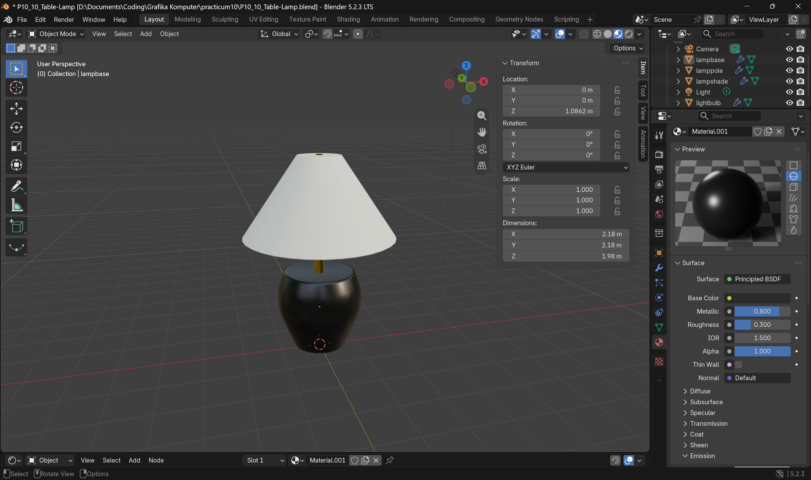

## 3. UV Mapping

### Mark Seams and Unwrap

UV seams were marked manually to control how each object was unfolded into 2D UV islands. The seam strategy was based on the shape and structure of each object.

| Object | Seam Strategy | Unwrap Method |
|:---|:---|:---|
| Lamp Base | Vertical seam at the rear and horizontal seams around the top and bottom | Angle Based |
| Lamp Pole | Vertical seam along the side and seams around the end faces | Angle Based |
| Lamp Shade | Vertical seam at the rear and a seam around the top face | Angle Based |
| Light Bulb | Automatically separated UV islands | Smart UV Project |

For the base, pole, and lampshade, Angle Based Unwrap was used to create UV islands based on the mesh geometry. For the bulb, Smart UV Project was used because of its rounded geometry.

### UV Island Explanation

Each UV island represents a section of the 3D mesh unfolded into a 2D surface. The islands were separated according to the geometry of each lamp component.

| Object | Main UV Islands | Purpose |
|:---|:---|:---|
| Lamp Base | Side surface and top/bottom faces | Separates the cylindrical side from its end surfaces. |
| Lamp Pole | Cylindrical side surface and end faces | Unwraps the long cylindrical surface and its caps. |
| Lamp Shade | Curved outer surface, top face, and inner surfaces | Separates the main shade surface from its additional surfaces. |
| Light Bulb | Multiple automatically generated islands | Separates the rounded surface into smaller UV sections. |

This separation helps organize the UV layout and allows textures to be applied across the different surfaces of each object.

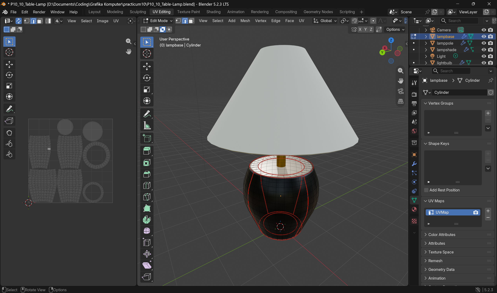

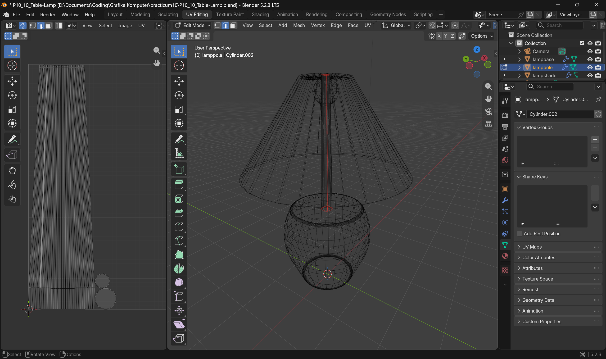

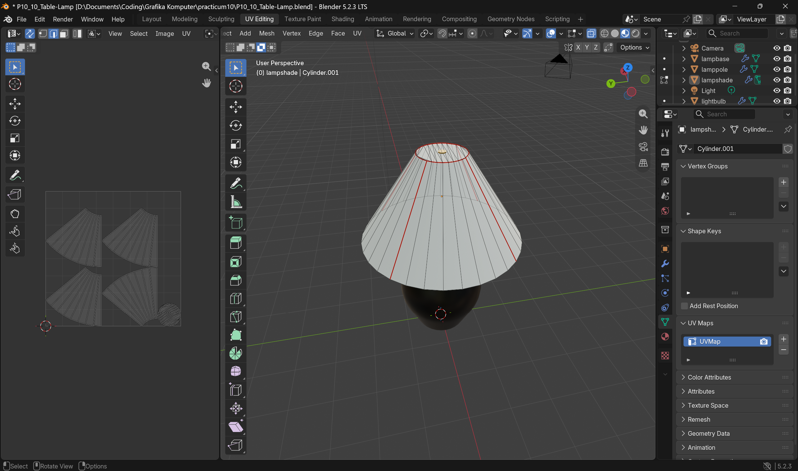

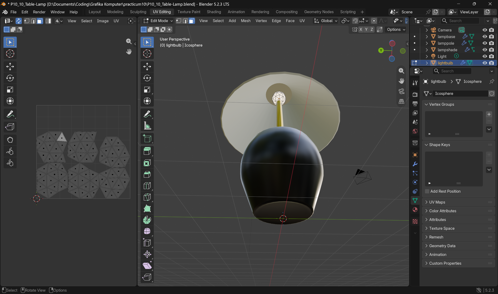

### Checker Texture Test

A checker texture was used to inspect UV stretching and distortion. The following node connections were used:

- Texture Coordinate – UV → Checker Texture – Vector
- Checker Texture – Color → Principled BSDF – Base Color

The checker pattern was inspected in Material Preview mode. This test helped identify whether the UV layout was stretched or distorted across the mesh surfaces.

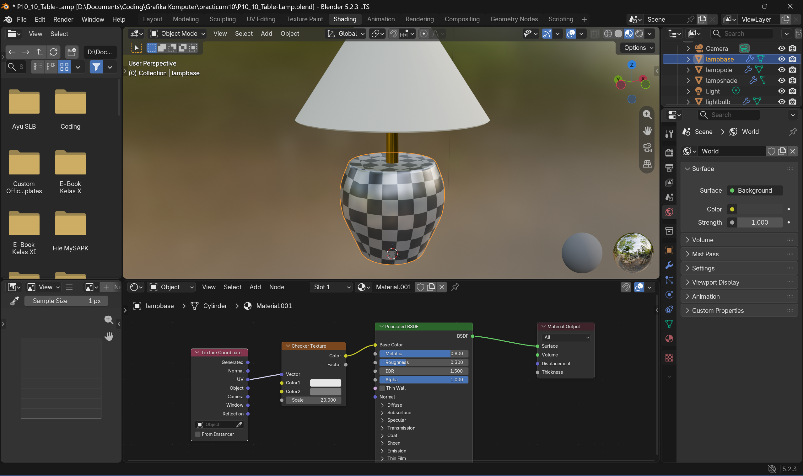

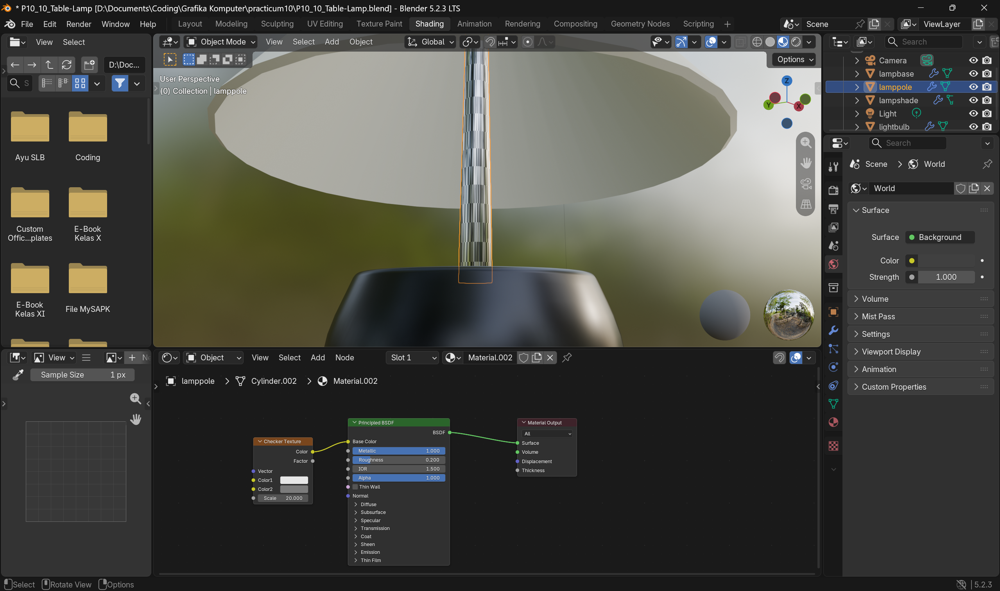

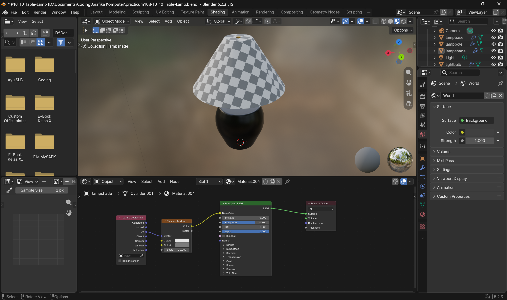

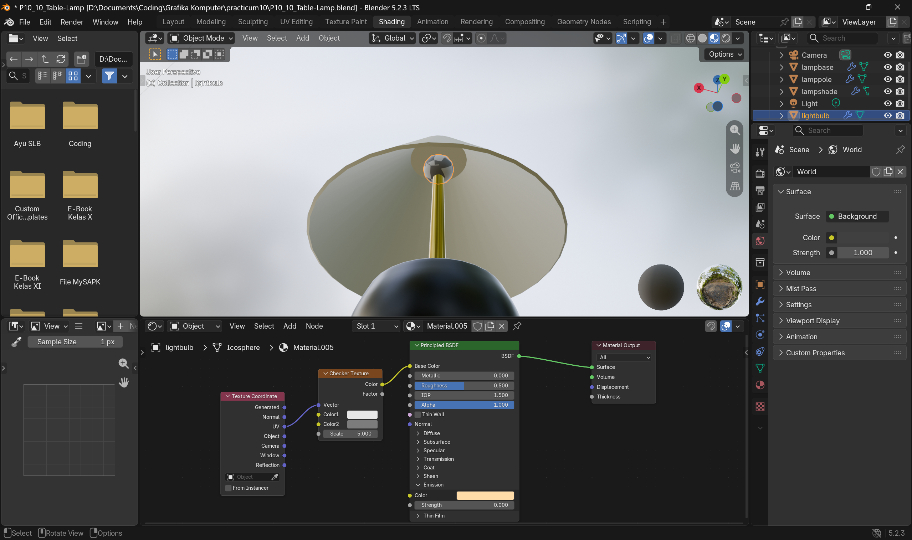

The checker test showed no significant stretching or distortion across the main surfaces of the lamp. The checker pattern was inspected to ensure that its squares remained reasonably consistent in size and shape. No major UV corrections were necessary after the initial unwrap.

### Texel Density and UV Packing

After checking the UV unwrap results, the UV islands were adjusted to achieve more consistent texel density.

The following operations were performed:

1. Select all UV islands in the UV Editor.
2. Use **Average Islands Scale** to normalize the relative scale of the islands.
3. Use **Pack Islands** to arrange the UV islands efficiently.
4. Check that the islands stay within the 0–1 UV space.
5. Inspect the spacing between islands to avoid unwanted overlap.

UV packing was performed separately for each object because the lamp parts use separate materials and texture sets.

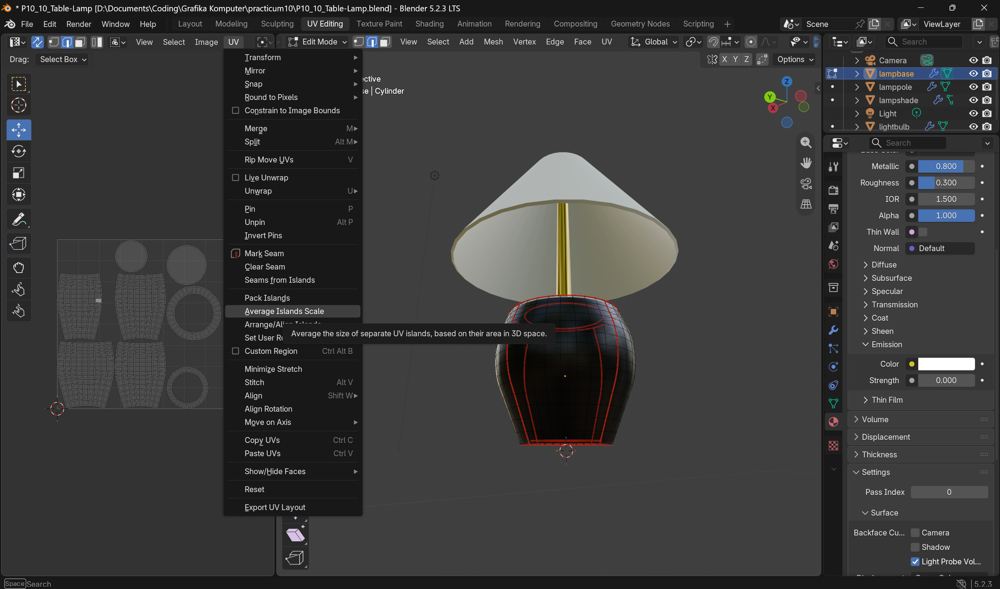

## 4. PBR Materials

### Create and Assign PBR Materials

PBR materials were configured using the Principled BSDF shader. The texture maps were connected to their corresponding inputs to create realistic surface appearances. The following texture maps were used:

| Texture Map | Color Space | Node Connection |
|:---|:---|:---|
| Base Color | sRGB | Image Texture → Principled BSDF Base Color |
| Roughness | Non-Color | Image Texture → Color Ramp → Principled BSDF Roughness |
| Metalness | Non-Color | Image Texture → Color Ramp → Principled BSDF Metalness |
| Normal | Non-Color | Image Texture → Normal Map → Principled BSDF Normal |
| Opacity | Non-Color | Image Texture → Color Ramp → Principled BSDF Alpha |
| Displacement | Non-Color | Image Texture → Displacement → Material Output Displacement |

The Normal Map texture was connected through a Normal Map node before being connected to the Principled BSDF Normal input. Color Ramp nodes were used to adjust the values of the Roughness, Metalness, and Opacity maps. The Displacement map was connected through a Displacement node to the Material Output Displacement input.

### Texture Sources

The PBR texture maps were obtained from ambientCG, which provides downloadable materials for 3D projects.

| Object | Texture | Source |
|:---|:---|:---|
| Lamp Base | Marble002 | https://ambientcg.com/view?id=Marble002 |
| Lamp Pole | Metal048A | https://ambientcg.com/view?id=Metal048A |
| Lamp Shade | Fabric019 | https://ambientcg.com/view?id=Fabric019 |

### Material Configuration

| Object | Material Appearance | PBR Configuration |
|:---|:---|:---|
| Lamp Base | Dark metallic surface | Base Color, Roughness, Metalness, Normal |
| Lamp Pole | Gold/brass metallic surface | Base Color, Roughness, Metalness, Normal |
| Lamp Shade | Beige fabric-like surface | Base Color, Roughness, Normal, Opacity, Displacement |
| Lamp Bulb | Warm glowing surface | Emission |

For the lampshade, a fabric-like appearance was selected to match the original beige design. The bulb retained its warm emission color (`#FFDCA8`) with an emission strength of `5.0`.

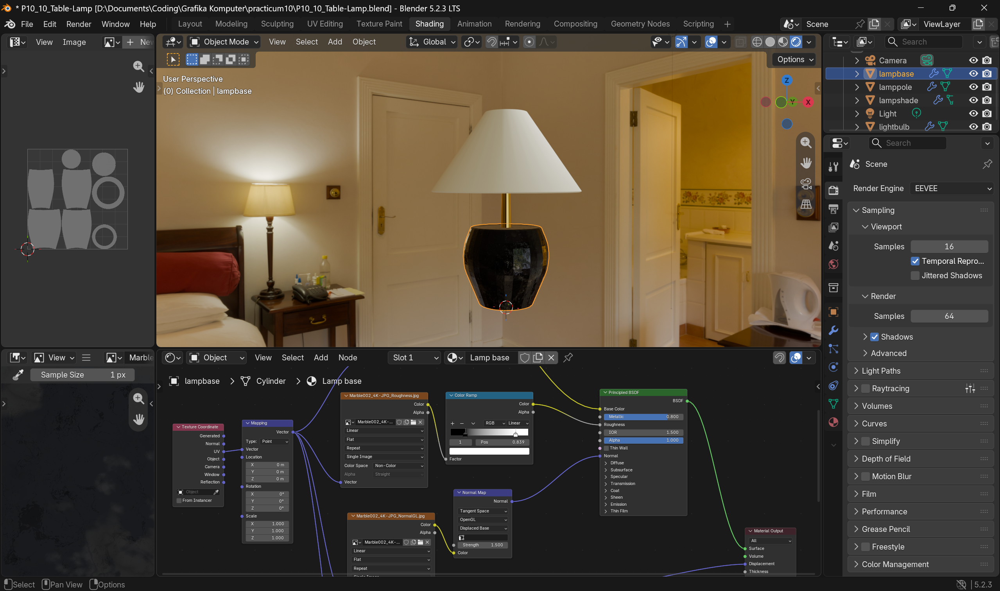

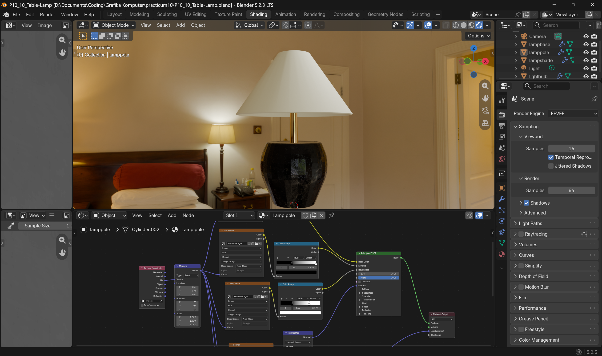

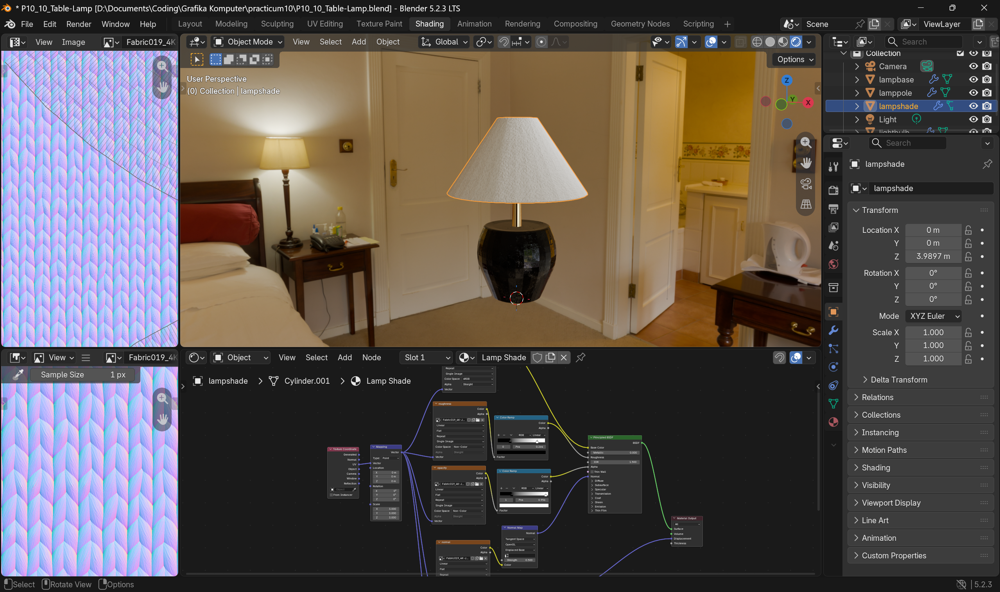

### Lighting and Final Material Check

The bulb uses an Emission material to create a warm glowing appearance. The following checks were performed:

1. Inspect the materials in Material Preview mode.
2. Switch to Rendered Viewport to inspect the final appearance.
3. Check that each texture map is connected to the correct node input.
4. Verify that the Normal Map uses a Normal Map node.
5. Check that the materials are assigned to the correct objects.
6. Save the Blender project.

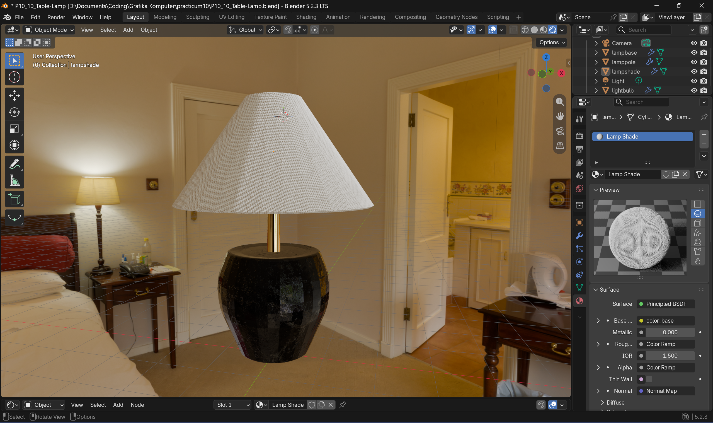

### Environment Lighting

An HDRI environment map from Poly Haven was used to provide environment lighting for the table lamp scene.

| Information | Details |
|:---|:---|
| Environment | Lythwood Room |
| Source | https://polyhaven.com/a/lythwood_room |
| License | CC0 |
| Purpose | Provides soft indoor illumination and environmental reflections |

The HDRI was used to create a more natural indoor lighting environment and enhance the appearance of the lamp materials during rendering.

### Texture File Management

All downloaded PBR texture maps were organized into separate folders according to their corresponding lamp objects inside the `textures/` directory. The texture files were kept together with the Blender project to maintain their availability when the project is moved to another location. The external texture paths were checked to ensure that no missing textures occurred when reopening the project.

## 5. Problems Encountered and Solutions

During the practicum, one issue was encountered when testing the Checker Texture. Initially, the checker pattern did not respond correctly to changes in the UV layout because the UV output was not connected to the Checker Texture Vector input. This was resolved by connecting the UV output from the Texture Coordinate node to the Vector input of the Checker Texture node. After making this connection, the checker pattern displayed correctly and could be used to inspect UV stretching and distortion.

## 6. Additional PBR Model Exploration

### Model Source and Information

For the additional PBR exploration, a Gothic Statue model was downloaded from Poly Haven in Blender (`.blend`) format.

| Information | Details |
|:---|:---|
| Model Name | Gothic Statue |
| Source | Poly Haven |
| File Format | Blender (.blend) |
| License | CC0 |
| Texture Maps | Base Color, Roughness, Normal (OpenGL) |

**Model Source:** https://polyhaven.com/a/gothic_statue

**License Information:** https://polyhaven.com/license

The model is released under the CC0 license, which allows it to be used, modified, and redistributed without requiring attribution.

### PBR Texture Maps

Three texture maps were used to configure the statue's material.

| Texture Map | Color Space | Principled BSDF Connection |
|:---|:---|:---|
| Base Color (Diffuse) | sRGB | Base Color |
| Roughness | Non-Color | Roughness |
| Normal (OpenGL) | Non-Color | Normal Map node → Normal |

The Base Color map provides the statue's surface color and visual details. The Roughness map controls how rough or smooth the surface appears. The Normal map adds surface detail by modifying the shading without changing the actual mesh geometry.

### Importing and Applying PBR Materials

The downloaded Blender file was opened in Blender to inspect the Gothic Statue model and its material setup. The texture maps were connected to the Principled BSDF shader using the following node configuration:

- Base Color Image Texture → Principled BSDF Base Color.
- Roughness Image Texture → Principled BSDF Roughness.
- Normal Image Texture → Normal Map node Color.
- Normal Map node Normal → Principled BSDF Normal.

The Base Color texture was set to sRGB, while Roughness and Normal textures were set to Non-Color. The Normal map was connected through a Normal Map node before reaching the Principled BSDF shader.

### Environment Lighting

An HDRI environment map from Poly Haven was used to provide environment lighting for the Gothic Statue scene.

| Information | Details |
|:---|:---|
| Environment | Museum of Ethnography |
| Source | https://polyhaven.com/a/museum_of_ethnography |
| License | CC0 |
| Purpose | Provides museum-style indoor illumination and environmental reflections |

The HDRI was used to create a museum-like lighting environment and enhance the statue's material appearance during rendering.

### Before and After Comparison

The model was inspected before and after applying the PBR texture maps. Before applying the PBR maps, the model was viewed using its initial material appearance. After connecting the Base Color, Roughness, and Normal maps, the material displayed more detailed surface colors, roughness variation, and normal-based surface details.

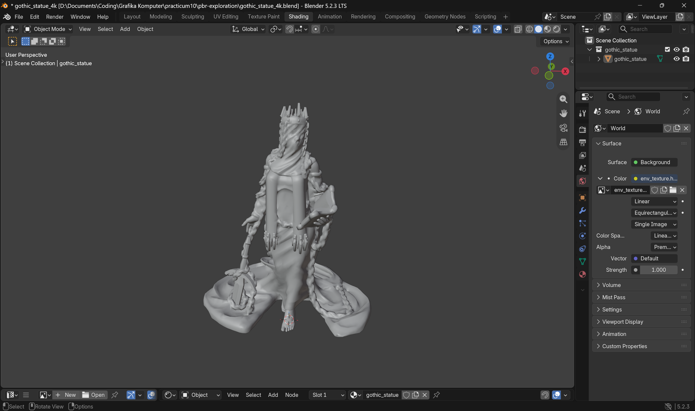

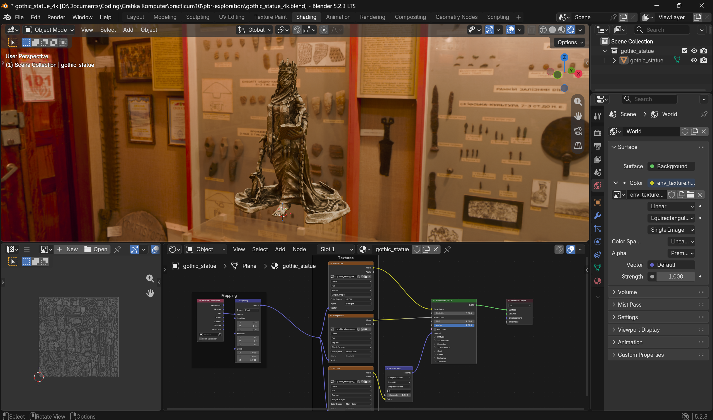

### Result

This exploration demonstrated how PBR texture maps can improve the visual appearance of an existing 3D model. By connecting Base Color, Roughness, and Normal maps to the Principled BSDF shader, the Gothic Statue gained more detailed and realistic material properties.

## 7. Challenges

Two challenges were completed during this practicum.

### Challenge 1: Multi-material Surface

The table lamp consists of multiple components with different material properties. Separate PBR materials were assigned to the lamp base, pole, and lampshade, while the bulb used an emission material. Each material was configured according to the surface characteristics of its corresponding object.

### Challenge 2: UV Optimization

UV optimization was performed by using Average Islands Scale and Pack Islands. These operations helped maintain more consistent relative texel density and organize the UV islands efficiently within the 0–1 UV space. The final layout was also inspected to ensure sufficient spacing and avoid accidental overlap.

## 8. Final Result

This practicum consisted of two main tasks: applying UV mapping and PBR materials to the table lamp created in Practicum 9, and exploring PBR texturing using an additional 3D model.

For the first task, the table lamp was prepared for UV mapping, unwrapped, and checked using a checker texture. The UV islands were adjusted using Average Islands Scale and Pack Islands. PBR texture maps were then connected to the Principled BSDF shader to improve the appearance of the lamp's base, pole, and lampshade. The bulb retained its warm emission material.

For the second task, a Gothic Statue model from Poly Haven was used to explore PBR texturing. Base Color, Roughness, and Normal maps were connected to the Principled BSDF shader to demonstrate how different texture maps affect the appearance of an existing 3D model.

## 9. Reflection

This practicum helped me understand how UV mapping connects 3D geometry to 2D textures. I learned how to mark seams, unwrap different mesh shapes, inspect UV distortion using a checker texture, and organize UV islands through Average Islands Scale and Pack Islands.

I also learned how different PBR maps affect material appearance and how to connect Base Color, Roughness, Metalness, and Normal maps to the Principled BSDF shader. Through the additional PBR exploration, I gained experience working with an existing 3D model and its texture maps. This helped me understand how PBR materials can improve surface details and make 3D assets look more realistic.