# Practicum 9 – Blender Fundamental 3D Modeling

**Author**: Anak Agung Putu Arda Nareswara  
**NRP**: 5025241074  
**Class**: B  
**Group**: 10

## 1. Concept
**Concept:** A simple modern table lamp made from basic primitives. The design uses a dark metallic base, a gold stem, and a matte white shade with a glowing bulb.

## 2. Initial Primitives
The model was built from these primitive objects:
| Object | Primitive | Purpose |
| :--- | :--- | :--- |
| Lamp base | Cylinder | Lamp base |
| Lamp pole | Cylinder | Lamp pole |
| Lampshade | Cylinder | Lampshade |
| Light bulb | Icosphere | Light bulb |

Each part was created as a separate object so it could be edited and assigned a material independently. 
## 3. Modeling Operations and Modifiers
| Tool / Modifier | Where it was used | Purpose |
| :--- | :--- | :--- |
| Loop Cut (Ctrl + R) | Lamp base | Adds edge loops to control the shape of the base. |
| Scale (S) | Base, lampshade, and pole | Adjusts the size and shape of each part. |
| Extrude (E) | Lamp pole | Extends the pole upward. |
| Inset (I) | Optional detail on the top face of the lamp base | Creates a smaller face and a border for a recessed detail. This operation is not shown in the supplied guide. |
| Delete Face (X) | Bottom of the lampshade | Opens the bottom of the shade. |
| Bevel (Ctrl + B) | Edges of the lamp base | Softens sharp edges. |
| Bevel Modifier | Lamp base | Adds smoother edges with adjustable settings. |
| Solidify Modifier | Lampshade | Adds thickness to the shade. |
| Shade Auto Smooth | All objects | Makes the surfaces look smoother. |

## 4. Modeling Process
### Step 1 – Create the Lamp Base
1. Start with a cylinder primitive.
2. Enter Edit Mode (Tab).
3. Use Loop Cut (Ctrl + R) to add supporting edge loops.
4. Scale (S) the upper and lower sections to form the base.

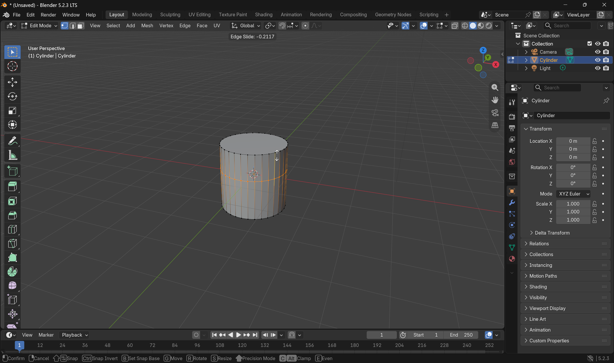
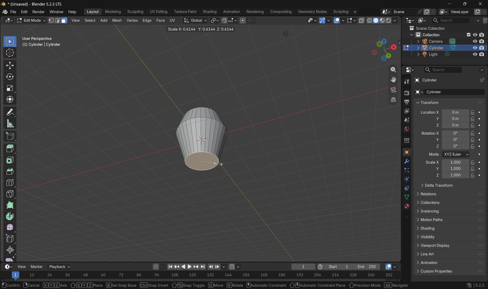

### Step 2 – Create the Lampshade
1. Return to Object Mode (Tab).
2. Add a new cylinder for the lampshade.
3. Enter Edit Mode and scale the upper and lower sections to shape the shade.
4. Select the bottom face and delete it to make the shade open.

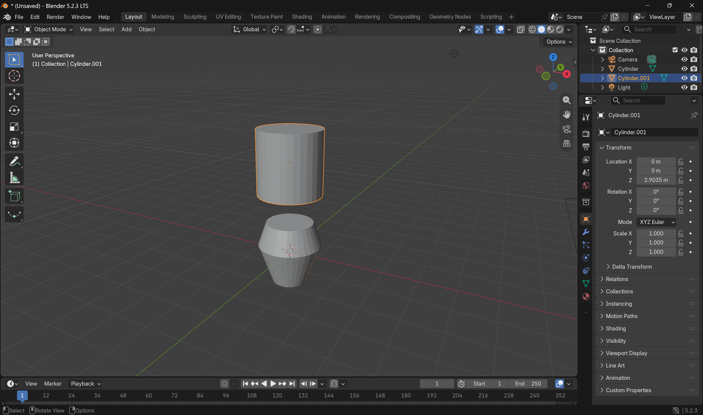
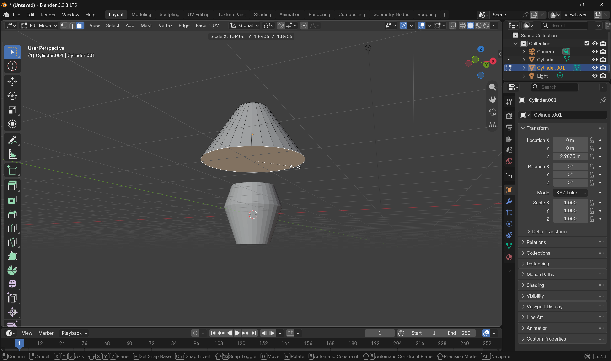
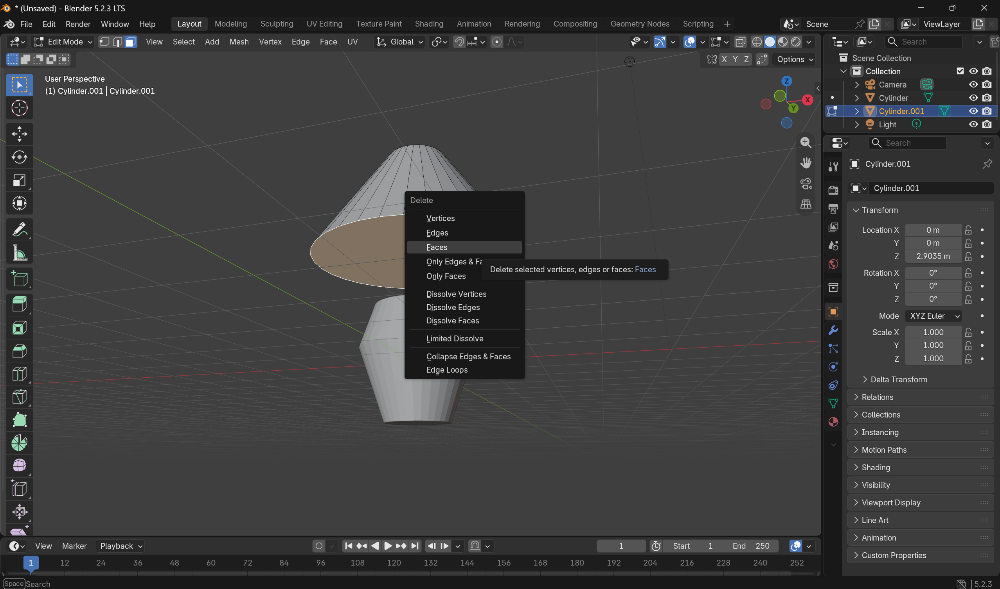

### Step 3 – Create the Pole and Bulb
1. Return to Object Mode before adding another primitive.
2. Add a new cylinder for the lamp pole.
3. Scale the cylinder down to make it thinner.
4. Enter Edit Mode and use Extrude (E) to extend the pole upward.
5. Add an Icosphere for the bulb.

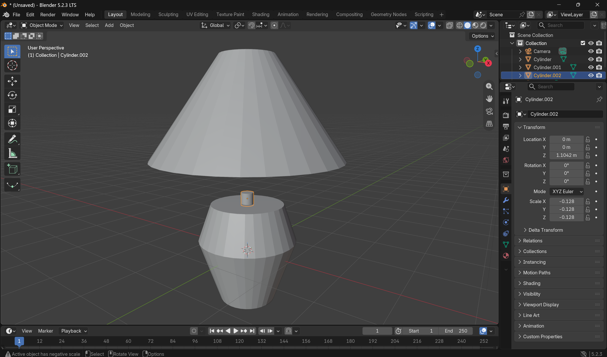
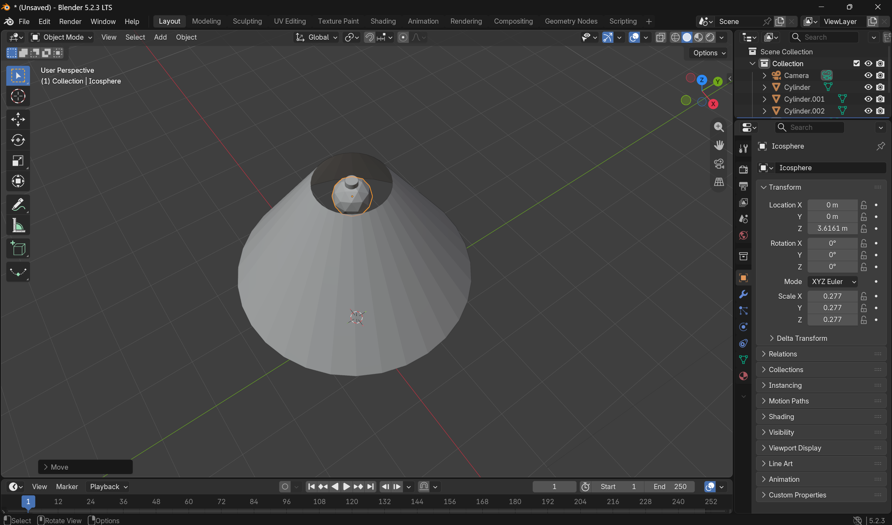

### Step 4 – Bevel the Lamp Base
1. Select the lamp base.
2. Enter Edit Mode and select the edges that need to be softened.
3. Use Bevel (Ctrl + B) to round the selected edges.

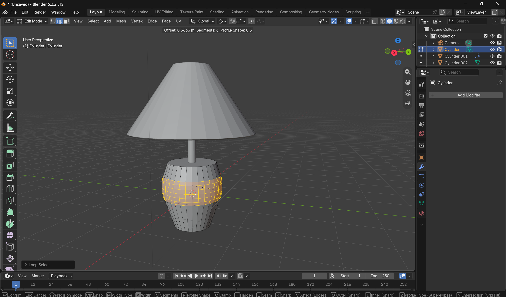

### Step 5 – Add Modifiers
**Bevel Modifier – Lamp Base**
- Amount: 0.05 m
- Segments: 10

**Solidify Modifier – Lampshade**
- Thickness: 0.05 m

The Bevel Modifier softens the base edges. The Solidify Modifier gives the lampshade visible thickness.

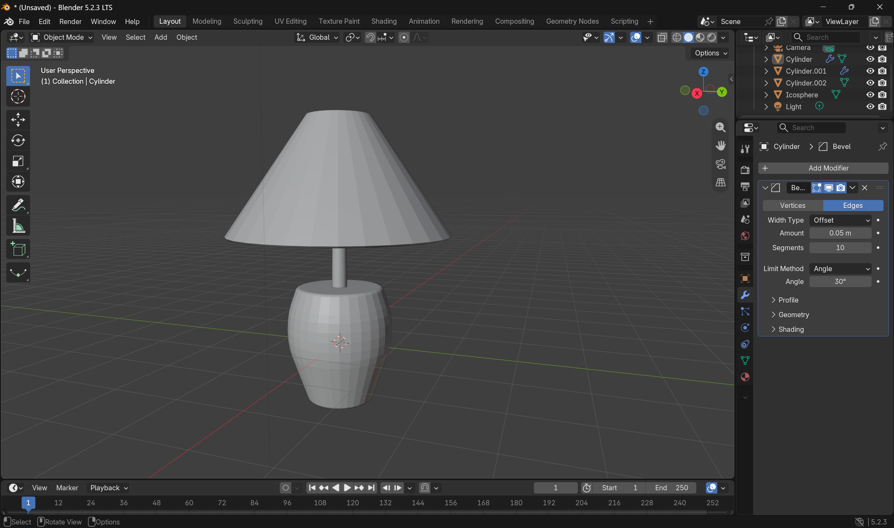
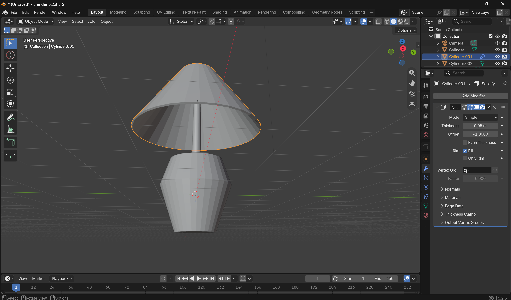

### Step 6 – Smooth the Objects
Use Shade Auto Smooth on all objects to improve the surface appearance. 
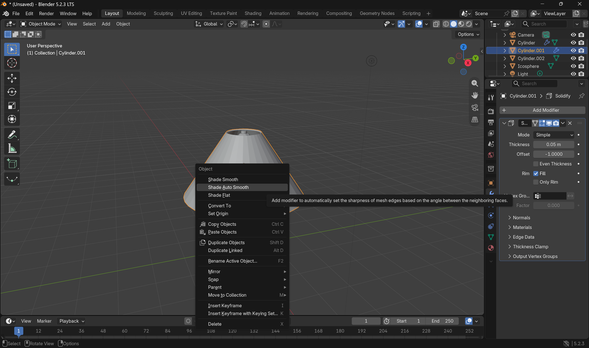

### Step 7 – Assign Materials
Create and assign a separate material to each object.
| Object | Base Color | Metallic | Roughness | Additional setting |
| :--- | :--- | :--- | :--- | :--- |
| Lamp base (Cylinder) | Dark Grey #2B2B2B | 0.8 | 0.3 | — |
| Lamp pole (Cylinder.001) | Gold #D4AF37 | 1.0 | 0.2 | — |
| Lampshade (Cylinder.002) | Beige #F5F5DC | 0.0 | 0.7 | — |
| Bulb (Icosphere) | White | — | — | Emission Color: #FFDCA8; Emission Strength: 5.0 |

The base and pole use metallic materials. The lampshade uses a matte material, while the bulb uses warm emission to create a glowing appearance. 

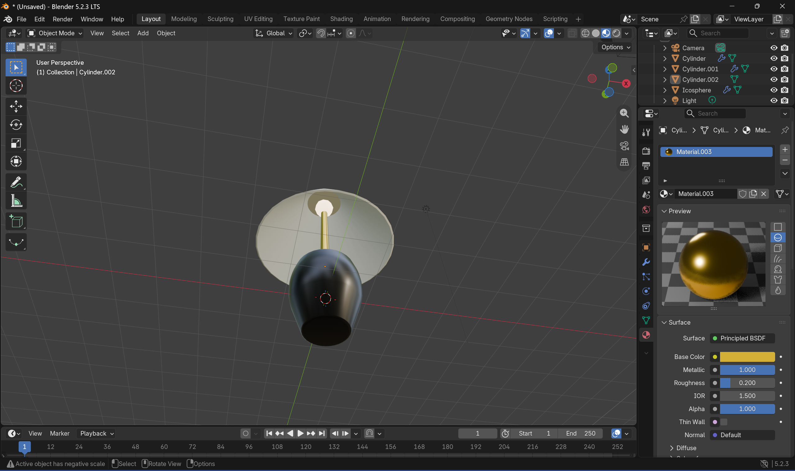

### Step 8 – Final Check
1. Inspect the lamp from the front, side, and perspective views.
2. Check that the base, pole, shade, and bulb are separate objects.
3. Check the Bevel and Solidify Modifier settings.
4. Check that the materials are assigned to the correct objects.
5. Save the Blender project.

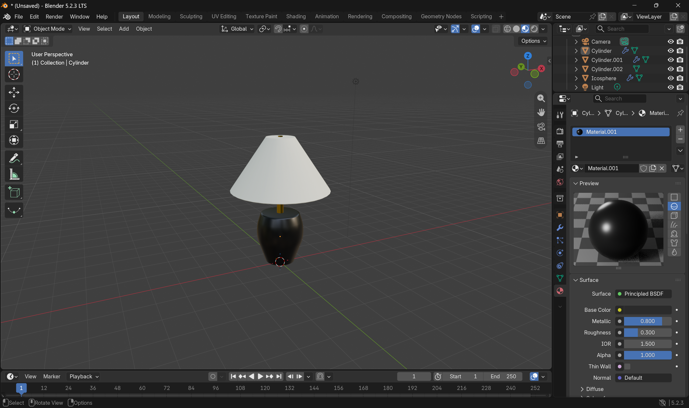

## 5. Problems Encountered and Solutions
During the modeling process, several issues were encountered. One common problem was that a newly added primitive would sometimes become part of the object currently being edited. To solve this, it was necessary to always return to Object Mode before adding a new primitive. This ensures that each part of the lamp, such as the base, pole, and shade, remains a separate object rather than merging into a single mesh

## 6. Final Result
The final asset is a table lamp consisting of a dark grey base, a gold pole, a beige open lampshade, and a warm glowing bulb. Loop Cut and Scale were used to shape the base and shade. Extrude was used to extend the pole, while Bevel and Solidify improved the finish and thickness of the model.

## 7. Reflection
This practicum helped me understand how to build an asset from basic primitives and edit each part separately. I learned how Loop Cut, Scale, Extrude, and Bevel affect mesh geometry. I also learned how Bevel and Solidify Modifiers can be adjusted before they are applied. Finally, I practiced assigning materials and adjusting their properties to give each part a different appearance.